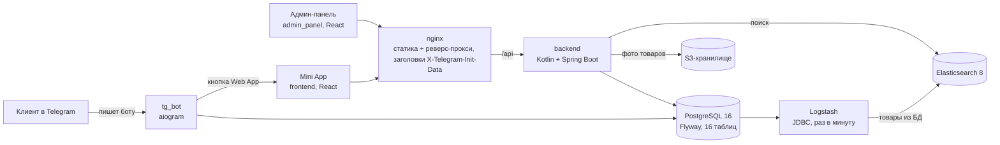

# Интернет-магазин в Telegram Mini App

Пет-проект. Full-stack e-commerce платформа: витрина и заказы внутри Telegram Mini App, отдельная админ-панель, Telegram-бот как точка входа. Демо-наполнение: канцелярия с символикой университета (45 товаров, 8 категорий), при старте Backend сам создаёт роли, категории и товары.

Пользователь пишет боту, жмёт «Запустить приложение», попадает в магазин. Авторизация без паролей: Mini App отдаёт Telegram InitData, backend проверяет подпись HMAC по токену бота и выдаёт свою пару JWT (access + refresh). Отдельной регистрации нет.

## Архитектура



Семь сервисов в одном `docker compose up` (postgres, elasticsearch, logstash, backend, telegram-bot, frontend, nginx; админ-панель подключается профилем `admin`).

## Функциональность

Витрина:
- каталог по категориям, фильтры по атрибутам товара (производитель, цвет, коллекция), сортировка;
- полнотекстовый поиск по товарам на Elasticsearch (Logstash раз в минуту синхронизирует товары из PostgreSQL);
- карточка товара с характеристиками, фото из S3, отзывами с оценкой;
- корзина и оформление заказа: способ оплаты на выбор (карта, наличные, Telegram Stars);
- избранное, история заказов, профиль пользователя;
- отзывы с фотографиями.

Админ-панель (отдельное React-приложение, вход по логину и паролю):
- дашборд и аналитика: статистика по заказам и статусам, сводка продаж, топ товаров;
- управление каталогом: создание и удаление товаров, категории и атрибуты, загрузка фото.

Backend:
- 17 контроллеров, 37 REST-эндпоинтов, Swagger UI по `/swagger-ui.html`;
- Spring Security: JWT access/refresh, проверка Telegram InitData (HmacSHA256), роли USER и ADMIN;
- 15 JPA-сущностей, схема полностью под управлением Flyway (одна стартовая миграция на 16 таблиц);
- фотографии товаров и отзывов в S3-совместимом хранилище (AWS SDK v2);
- при первом запуске создаёт роли, админа и наполняет каталог демо-товарами.

## Стек

Backend: Kotlin 1.9, Spring Boot 3.4 (Web, Security, Data JPA, Data Elasticsearch), Flyway, jjwt, AWS SDK S3, springdoc-openapi. Сборка Gradle, Java 17.
Frontend и админка: React 19, TypeScript, Vite, Ant Design, TanStack Query, @telegram-apps/sdk-react.
Бот: Python 3.11, aiogram 3, SQLAlchemy (asyncpg).
Инфраструктура: Docker Compose, PostgreSQL 16, Elasticsearch 8, Logstash, nginx.

## Запуск

Нужны Docker и токен бота из @BotFather.

```bash
cp .env.example .env
# заполнить: TELEGRAM_BOT_TOKEN, JWT_SECRET_KEY (openssl rand -hex 32),
# S3_ACCESS_KEY / S3_SECRET_KEY — для фото; без них товары создадутся без картинок
docker compose up -d --build
```

- витрина: http://localhost:3000 (внутри Telegram: Web App URL бота должен указывать на ваш HTTPS-домен, для Mini App это обязательное требование);
- API и Swagger: http://localhost:8080/swagger-ui.html;
- админка: `docker compose --profile admin up -d`, http://localhost:3002, учётка задаётся в `.env` (`APP_ADMIN_LOGIN` / `APP_ADMIN_PASSWORD`, по умолчанию admin/admin).

Без каталога изображений (`SEED_IMAGES_DIR`) демо-товары создаются без фотографий. Все пароли, ключи и токены берутся из `.env`, в репозитории только `.env.example` с плейсхолдерами.

## Структура

```
backend/       Kotlin + Spring Boot API (ru.webshop)
frontend/      Mini App: React 19 + @telegram-apps/sdk
admin_panel/   админ-панель на React
tg_bot/        Telegram-бот (aiogram), кнопка запуска Mini App
conf/          пайплайн Logstash: PostgreSQL -> Elasticsearch
nginx/         реверс-прокси: статика + API
```

## Статус

Пет-проект, развивается в свободное время. Платёжных интеграций нет: заказ фиксирует способ оплаты, деньги не списываются.
